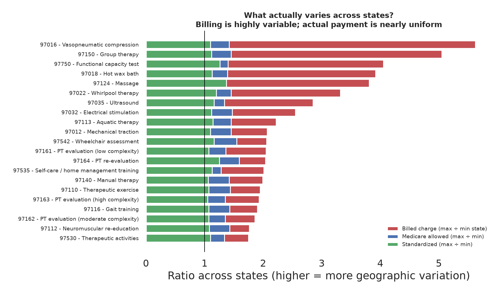
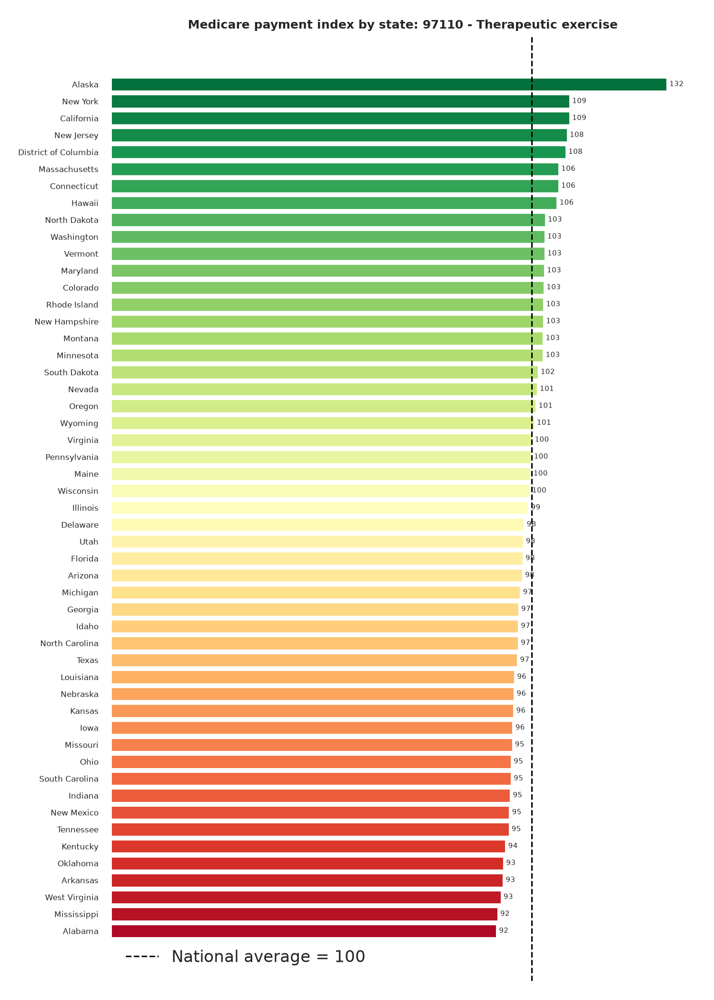
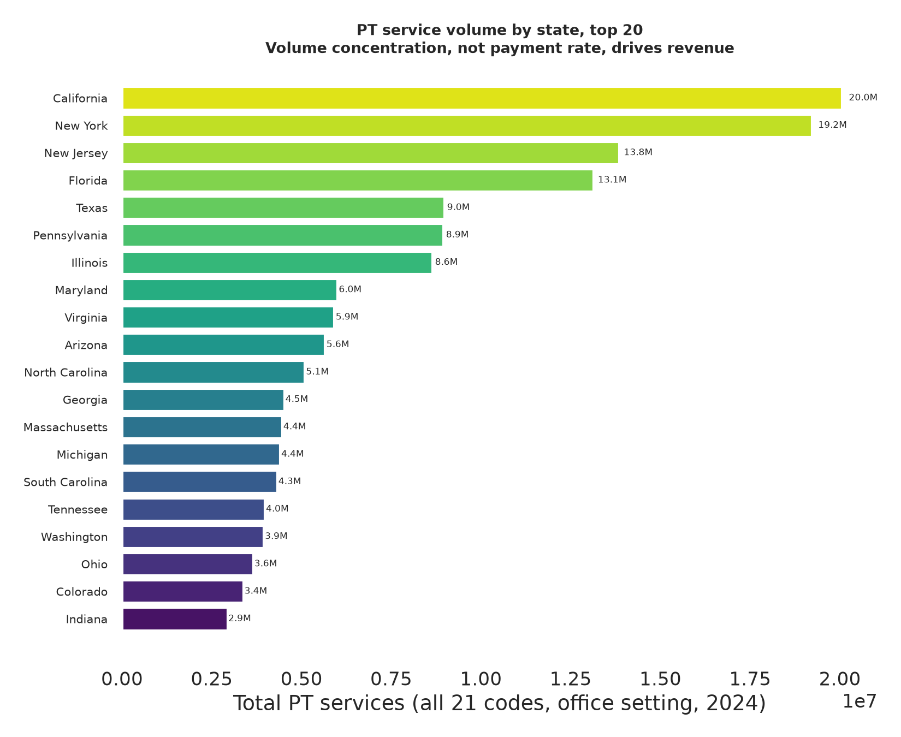
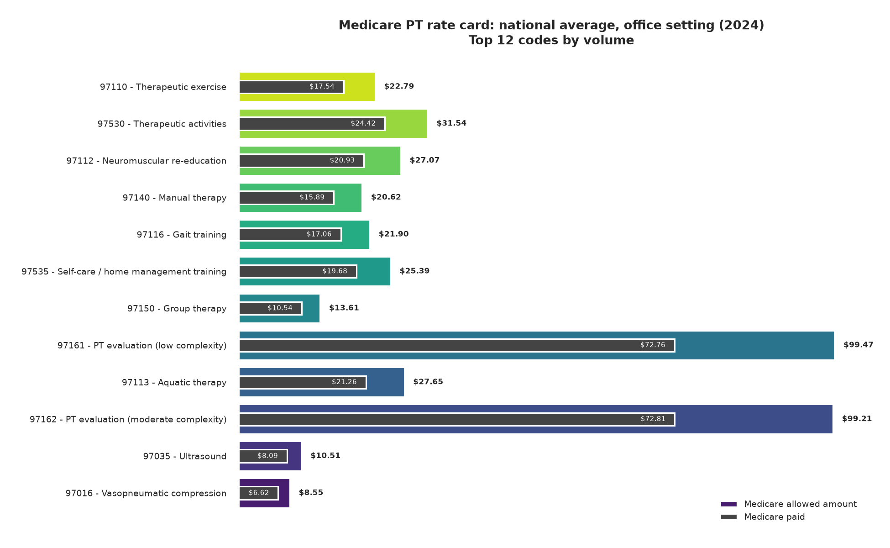

# Physical Therapy Payment & Market Analysis: Medicare, 2024

**Business question:** Where in the US is Medicare's physical therapy dollar spent, how much does the
payment rate for the same therapy service vary between states, and how much of that variation is
real price difference versus billing behavior?

**Stakeholder:** A therapy practice owner, a rehab network's finance lead, or a payer's network
contracting team deciding where to expand or how to benchmark a contract.

**Headline finding:** Billing is highly variable, but payment is not. Across 21 PT service codes,
the amount providers *bill* varies about **2.1×** from the lowest to the highest state, but the
amount Medicare *allows* varies only **1.42×**, and after geographic standardization just **1.12×**.
States that look expensive on paper are mostly billing aggressively, not getting paid more.

---

## Why I built this

I'm a licensed physical therapist moving into data analytics. Most entry-level portfolios analyze
retail or generic Kaggle data, where domain expertise adds nothing. Therapy billing data is
different: interpreting it correctly requires knowing that `97110` is billed in 15-minute units,
that the *allowed amount* is not the *paid amount*, and that a therapist's utilization pattern has a
clinical reason behind it. This project is where my clinical background does work a bootcamp
graduate's cannot.

## Data

- **Source:** [CMS Medicare Physician & Other Practitioners, by Geography and Service](https://data.cms.gov/provider-summary-by-type-of-service/medicare-physician-other-practitioners/medicare-physician-other-practitioners-by-geography-and-service)
- **Release:** Data year 2024 (Public Use File, published May 2026, free, no registration)
- **Full file:** 268,350 rows · 9,403 HCPCS codes · 61 geographies · ~42 MB
- **This analysis:** 21 physical therapy service codes (CPT 97000–97799). The committed extract is
  1,292 rows; per-state comparisons run on **1,058 state-level office rows across 50 states + DC**
  (the `v_state_office` view drops territories and Armed Forces regions)
- **Grain:** one row per geography × HCPCS code × place of service
- **Beneficiaries:** Medicare Part B fee-for-service (Original Medicare), *not* Medicare Advantage

### Key fields

| Field | Meaning |
|---|---|
| `Rndrng_Prvdr_Geo_Lvl` | `National` or `State`. National rows are a separate aggregate, **not** the sum of states |
| `Place_Of_Srvc` | `O` = office/outpatient (the main PT setting), `F` = facility |
| `Tot_Srvs` | Services rendered (a 15-min unit is one "service") |
| `Avg_Sbmtd_Chrg` | What providers billed |
| `Avg_Mdcr_Alowd_Amt` | Maximum Medicare will pay for the code |
| `Avg_Mdcr_Pymt_Amt` | 80% of allowed, after patient deductible/coinsurance |
| `Avg_Mdcr_Stdzd_Amt` | Payment with geographic cost differences **removed**, the fair-comparison field |

## Pipeline

```
CMS public use file (42 MB)
  └─ scripts/fetch_data.py   → subset to 21 PT codes → data/pt_geo_2024.csv (0.24 MB)
       └─ scripts/build_db.py → SQLite + indexes + v_state_office view → data/pt_market.db
            └─ scripts/analyze.py → 5 SQL queries → outputs/*.csv + figures/*.png
                 └─ notebooks/pt_payment_analysis.ipynb → the same SQL, plotted inline
```

**Notebook version:** `notebooks/pt_payment_analysis.ipynb` runs the same SQL against an in-memory
build of the same database, with the charts rendered inline.

Reproduce in full:

```bash
pip install -r requirements.txt
python scripts/fetch_data.py     # ~42 MB download, then subsets to PT codes
python scripts/build_db.py
python scripts/analyze.py
```

To run the notebook as well (it needs Jupyter, which the pipeline scripts do not):

```bash
pip install jupyterlab
jupyter lab notebooks/pt_payment_analysis.ipynb
```

## Findings

### 1. The service line is large and concentrated

194.2 million PT services in 2024, representing roughly **$4.0 billion** in estimated Medicare
payment, spread across 21 codes. Nine codes account for essentially all of the volume.

### 2. The rate card and the write-off it implies

| Code | Service | Services | Billed | Medicare allowed | % of billed paid |
|---|---|---|---|---|---|
| 97110 | Therapeutic exercise | 64.2M | $69.14 | $22.79 | 25.4% |
| 97530 | Therapeutic activities | 44.6M | $74.55 | $31.54 | 32.8% |
| 97112 | Neuromuscular re-education | 34.8M | $72.64 | $27.07 | 28.8% |
| 97140 | Manual therapy | 29.3M | $67.80 | $20.62 | 23.4% |
| 97116 | Gait training | 5.0M | $56.50 | $21.90 | 30.2% |
| 97161 | PT evaluation (low complexity) | 1.7M | $192.71 | $99.47 | 37.8% |

Providers bill roughly 3–4× what Medicare allows. That gap is not a finding about greed; it is the
standard contracting posture in fee-for-service, and it sets the baseline a practice negotiates
against.

### 3. The main finding: price vs. billing behavior

Comparing each state's allowed amount for a code against the national average for that same code:

| What varies | Median max÷min across states |
|---|---|
| Billed charge | **2.06×** |
| Medicare allowed amount | 1.42× |
| Standardized amount (geography removed) | **1.12×** |



Alaska is the only genuine outlier at a payment index of **132**: its allowed amount of $29.74 runs 32%
above the average state rate. Every other state sits between **91.6 and 109.1**, a band of about 17
index points. Its *submitted charge* of $96.85 is second only to New Jersey's $98.99, against a state
low of $50.84 in Idaho.

That payment-index gap is mostly geographic price adjustment rather than billing behaviour:
standardizing the allowed amount collapses the 91.6 to 132 spread to **97 to 104**. Billing behaviour
is what shows up in the submitted charges, where the same code varies 2.06x across states, not in the
payment index. The standardized column is the one to compare on.



### 4. Volume, not rate, drives revenue

California ($20.0M services), New York (19.2M), New Jersey (13.8M), and Florida (13.1M) account for
a third of all PT volume. In a service line this flat on price, a practice's revenue is a
utilization story.





## Limitations

The limits of what this data supports.

1. **This is Original Medicare Part B only.** It excludes Medicare Advantage, commercial insurance,
   Medicaid, workers' compensation, and self-pay, which together are the majority of most therapy
   practices' revenue. Nothing here generalizes to a practice's full payer mix.
2. **Aggregate state averages, not provider-level data.** A state average blends every provider in
   the state; it cannot be used to benchmark one clinic against its peers.
3. **CMS redacts small cells.** Any cell representing fewer than 11 beneficiaries is suppressed, so
   low-volume codes and small states are under-represented and averages for them are noisier.
4. **"Allowed amount" ≠ collected revenue.** It ignores patient cost-sharing, denials, and bad debt.
   The $4.0B estimate is a gross payment estimate, **not** net revenue.
5. **Provider and beneficiary counts are summed across codes and double-count.** A clinic billing
   eight codes is counted eight times. They are row-count aggregates rather than unique counts.
6. **Standardization methodology is CMS's, not mine.** I treat `Avg_Mdcr_Stdzd_Amt` as the fair
   comparison field but have not validated CMS's geographic adjustment method.
7. **One data year, no trend.** Rate changes, policy shifts, and the 2021 telehealth expansion
   cannot be seen. Prior years are available from the same source.
8. **The 21-code list is mine.** It deliberately excludes occupational therapy, speech therapy, and
   wound care codes, some of which appear under 97xxx.

## Next steps

- Pull 2019–2024 to test whether the price band is widening or has been flat
- Add the *by Provider and Service* file, aggregate to provider level, and identify what separates
  high- vs. low-utilization practices in the same state
- Overlay state population 65+ to convert volume into utilization per capita, the real market map
- Check whether the 1.12× standardized band holds for occupational therapy (97165–97168), which
  shares the same fee schedule family

## Repo contents

```
notebooks/               narrated walkthrough (same SQL, plots inline)
scripts/fetch_data.py    download + subset to PT codes
scripts/build_db.py      load to SQLite, add indexes and the state-office view
scripts/analyze.py       5 SQL queries, 4 figures, 5 CSVs
data/pt_geo_2024.csv     committed (0.24 MB) so the analysis runs without a re-download
data/pt_market.db        SQLite, built by script (not committed)
.gitignore               keeps the 42 MB raw file and built DB out of git
outputs/                 query results as CSV
figures/                 charts
```

`data/pt_geo_2024.csv` is committed on purpose: it is small enough to ship and lets a reviewer run
`build_db.py` and `analyze.py` without the 42 MB download.

`HCPCS_Cd` is pinned to text on read and write, because it is an identifier rather
than a number.
